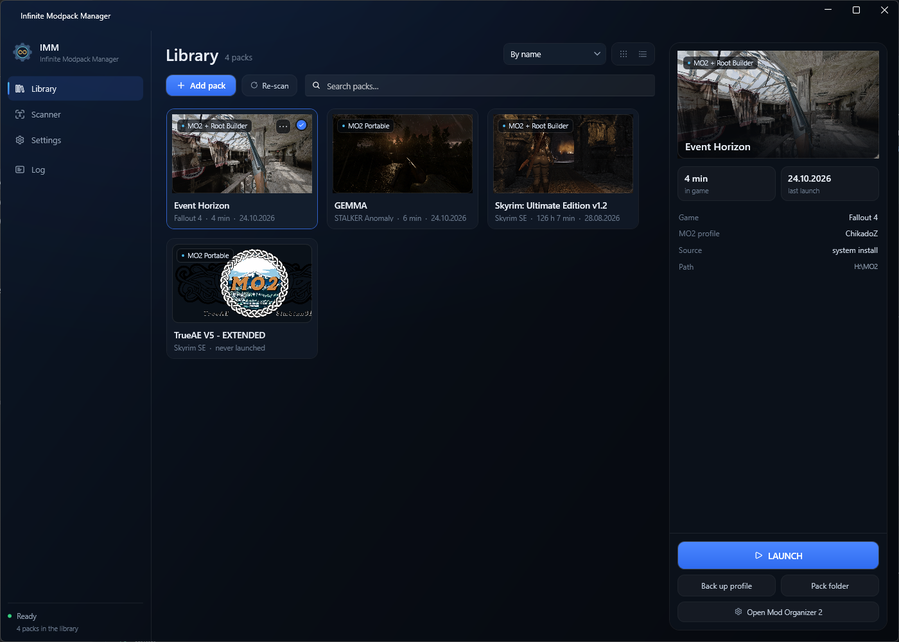
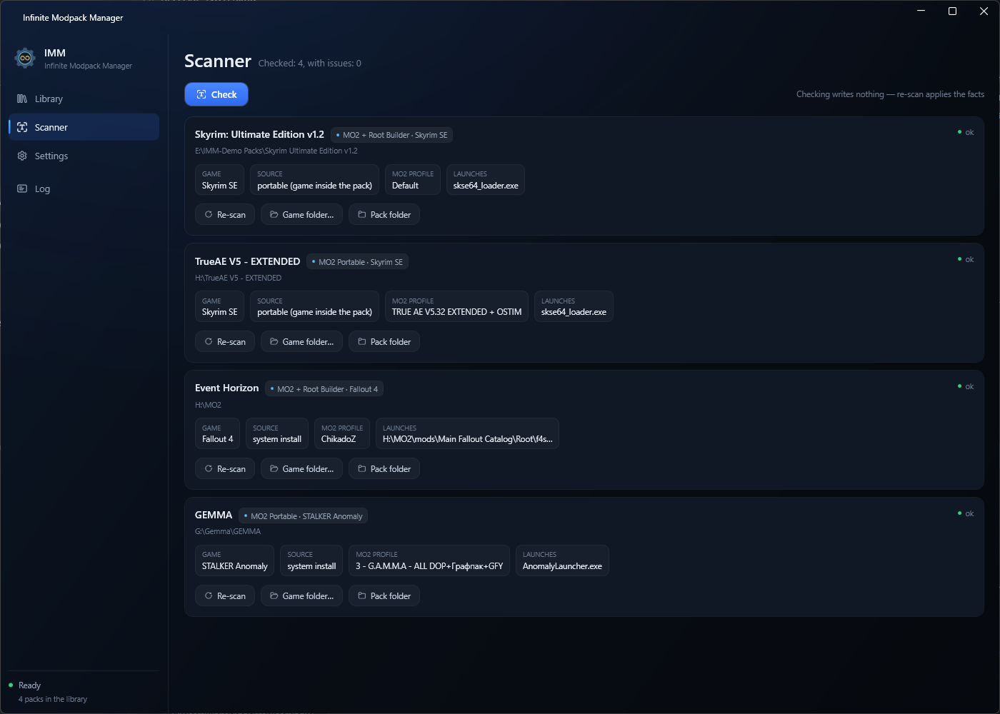
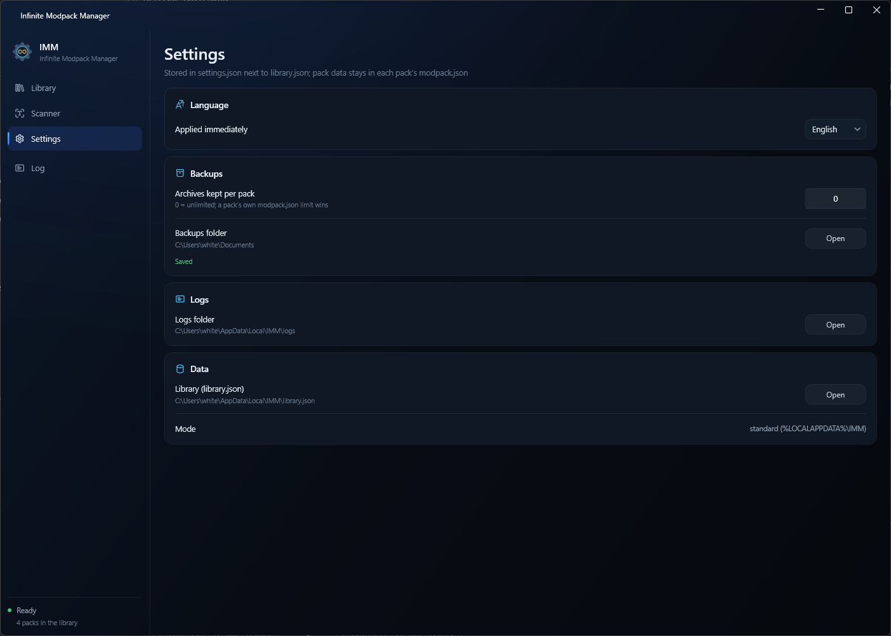

# Infinite Modpack Manager (IMM)

A local, offline launcher and library for your modpack collections — a kind of *Playnite for modpacks*.

Point IMM at a pack folder and press **LAUNCH**. No manual path fixing in Mod Organizer 2, no `.bat`
files, no "why won't it start" evenings.

> **Status: beta (v1.0.0-beta.2).** Core features are done and tested against real Fallout 4, Skyrim SE
> and STALKER G.A.M.M.A. packs. Bug reports go to [Issues](https://github.com/21whitenight12/InfiniteModpackManager/issues).

---

## Screenshots

**Library** — cards with covers and playtime, plus the detail panel with one-click launch:



| Scanner | Settings |
|---|---|
|  |  |

## What it does

| | |
|---|---|
| **Library** | Import a pack folder (drag & drop or the *Add pack* button), get a card with a cover, playtime and last launch. Grid or list view, search, sort by name / last launch / playtime. |
| **Scanner** | Detects the game, the engine (Direct / MO2 / MO2 + Root Builder) and the MO2 profile heuristically, and shows the result side by side with what the stored manifest claims, so you can see drift. Anything ambiguous is flagged instead of silently guessed. |
| **Launch** | One button. IMM resolves the right binary (Script Extender loader over the bare game exe), starts MO2 with the correct profile and executable, and asks for UAC elevation only when the pack actually needs it. |
| **Self-healing paths** | IMM points MO2 at the game your pack actually uses: a `gamePath` left over from another install, pointing nowhere, or missing altogether is rewritten automatically — with a timestamped backup written first. Qt `@ByteArray` escaping (including non-ASCII profile names) is decoded properly. |
| **Backups** | One click packs the whole MO2 profile (modlist, plugins, ini, saves) or the Direct install's save folder into a timestamped ZIP in your Documents, with an optional retention limit and a pin flag. |
| **Playtime** | Session tracking that survives MO2's elevated process and the F4SE/SKSE bootstrap (the game process can change mid-launch). Written to the library on session end. |
| **English / Русский** | Switchable in Settings, no restart needed. |

## Supported games

| Game | Detection marker | Launch |
|---|---|---|
| Skyrim LE | `TESV.exe` | Direct or MO2 (+ Root Builder) |
| Skyrim SE / AE | `SkyrimSE.exe` | Direct or MO2 (+ Root Builder) |
| Fallout 4 | `Fallout4.exe` | Direct or MO2 (+ Root Builder) |
| Fallout NV | `FalloutNV.exe` | Direct or MO2 (+ Root Builder) |
| STALKER Anomaly / G.A.M.M.A. | `AnomalyLauncher.exe` | MO2 + Anomaly launcher |

Three MO2 instance layouts are handled: the classic one (`ModOrganizer.exe` + `ModOrganizer.ini` in the
pack root), the "game in the root, MO2 in a single subfolder" layout that Root Builder packs use, and the
portable "stock game" layout where the game sits in a subfolder of its own (`<pack>\Skyrim`,
`<pack>\Anomaly` — any name). Only **portable** MO2 instances are supported — global instances in
`%LOCALAPPDATA%\ModOrganizer` are deliberately out of scope.

## Requirements

- Windows 10 1607 or newer, x64. Windows 11 recommended (the Fluent backdrop degrades to a solid
  colour on older builds — expected, not a bug).
- **Nothing else.** The executable is self-contained: no .NET runtime, no installer, no dependencies.

## Download & run

1. Grab `Imm-1.0.0-beta.2-win64.zip` from [Releases](https://github.com/21whitenight12/InfiniteModpackManager/releases).
2. Unpack it anywhere (a normal folder, not `Program Files` — IMM needs to write next to itself only in
   portable mode, but a writable folder avoids surprises).
3. Run `Imm.App.exe`. Windows SmartScreen may warn about an unsigned binary — verify the SHA-256
   published with the release before clicking *More info → Run anyway*.
4. Press **Add pack** (or drop a pack folder onto the window) and pick the pack root — the folder that
   contains `ModOrganizer.exe`, or the game root for Direct installs.

## What IMM writes, and where

IMM is a local tool: everything it touches is on your disk, and it tells you exactly what.

| Path | When | Why |
|---|---|---|
| `%LOCALAPPDATA%\IMM\library.json` | adding / removing packs, session end | library index (name, path, playtime, last launch) |
| `%LOCALAPPDATA%\IMM\settings.json` | changing settings | language, backup limit, last selected pack |
| `%LOCALAPPDATA%\IMM\logs\*.log` | always | diagnostic log, size-capped |
| `<pack>\modpack.json` | first scan, re-scan, manual override | per-pack manifest: detected game, engine, profile, launch binary |
| `<pack>\ModOrganizer.ini` + `ModOrganizer.ini.bak-<timestamp>` | **only** when the game path inside the ini is wrong for this pack (points at another install, at a folder that no longer exists, or is missing while the pack carries its own game) | self-healing; the backup is written before the change, and the patcher is idempotent |
| `Documents\<pack-id>\<yyyyMMdd-HHmmss>.zip` | when you press *Back up profile* | profile or save archive (OneDrive redirection is respected) |

If a `library.json` sits next to `Imm.App.exe`, IMM runs in **portable mode** and keeps its data there
instead of `%LOCALAPPDATA%` — handy for a USB stick or a clean test profile.

### Privacy

IMM makes **no network requests at all** — no telemetry, no update checks, no account, no crash
reporting. The only outgoing traffic in its lifetime is whatever MO2 and the game do themselves.

## Build from source

Requires the .NET 10 SDK.

```bash
dotnet build Imm.sln -c Release
bash scripts/run_tests.sh      # Release + warnings-as-errors + the full xUnit suite
bash scripts/publish.sh        # -> publish/Imm.App.exe (single-file, self-contained, ReadyToRun)
```

Layout: `src/Imm.Core` (net10.0-windows, no WPF: scanner, launch strategies, INI patcher, backups,
domain models), `src/Imm.App` (WPF + WPF-UI, MVVM via CommunityToolkit, Generic Host as the
composition root), `tests/Imm.Core.Tests` (xUnit).

## What's new in v1.0.0-beta.2

- **The pack's own game is found and used.** A pack moved to another disk keeps the previous MO2 game
  path, so MO2 used to mount *another* install's `Data` folder — missing masters, an error dialog and an
  instant crash. IMM now detects the game folder inside the pack (any subfolder name), reports the
  mismatch in the Scanner and switches MO2 to it on launch.
- **Every wrong game path is repaired, not reported.** A `gamePath` that points at another install, at a
  missing folder, or that is absent is rewritten to the game the pack really uses (own game → system
  install → pack game root), always with a timestamped backup. No more "fix it in MO2 by hand".
- **Several game-looking folders are resolved** by a fixed priority (the folder the ini names → the game
  type the ini declares → a complete install with `Data` + script extender → `Data` present → the freshest
  game exe) and the pick is reported as a warning instead of a "choose manually" notice.
- 143 unit tests (was 132).

## Known limitations

- Backups are manual only — by design.
- The backup **list** screen (pin / delete / size) is not in this beta; the engine supports it, the UI
  does not yet.
- No modlist or plugin editing — IMM is a launcher, not a mod manager.
- No pack relocation between drives, no Nexus/Wabbajack integration, no sync.
- MO2 2.5.2 crashes (0xC0000005) when `-p` receives a non-ASCII profile name. IMM works around it by
  writing the profile into the ini instead, but a pack with a non-ASCII profile needs a recent MO2 build.

## License

MIT — see [LICENSE](LICENSE).
